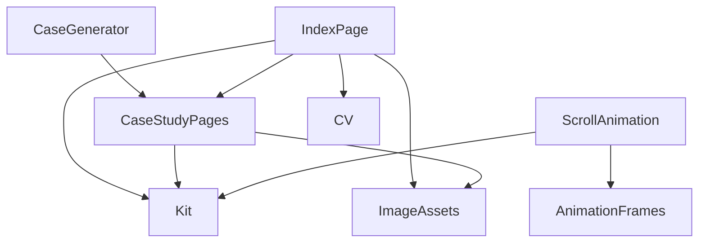

# AboutMe — Architecture

## 1. Stack
- HTML5, CSS3, vanilla JavaScript modules; no framework, no build step, no `package.json`. (README.md)
- A design-system kit in `assets/` (tokens, grid, nav, cards, motion, scroll moments, icons). (assets/)
- Fonts: Newsreader and Hanken Grotesk from Google Fonts. (index.html)
- One Python script generates the five case pages. (scripts/build_case_pages.py)

## 2. Directory map
| path | what lives there |
|---|---|
| index.html | The hub: hero, client work, products, statement, automation, stack, repositories, about, contact |
| pos.html, automation.html, ecommerce.html, ai-dev.html, websites.html | Case studies, generated by scripts/build_case_pages.py |
| wpdev.html | Scroll-animation experiment with its own canvas script |
| scripts/build_case_pages.py | Shared head, nav, footer and the five case-page bodies |
| assets/ | The kit the pages load: system.css/js, layout/, ui/, motion/, moments/, icons/, backgrounds/ |
| images/, parmacyShop/, MegaBazar/, Animation/ | Portraits, screenshots, GitHub captures, the 52-frame sequence |
| Siam-Hossain-CV.pdf, Certificates/ | CV and certificates linked from the pages |

## 3. Diagram

## 4. Component index
- [[IndexPage]]
- [[CaseStudyPages]]
- [[CaseGenerator]]
- [[Kit]]
- [[ImageAssets]]
- [[ScrollAnimation]]
- [[AnimationFrames]]
- [[CV]]

## 5. Entry points
- **Dev:** `python3 -m http.server 8765` in the repo root → `http://127.0.0.1:8765`. (README.md)
- **Prod:** static hosting of the repo root on GitHub Pages, `https://alphaman-0.github.io/AboutMe/`. (README.md)

## 6. Conventions (observed)
- Every `main > section` is one or two screens tall (`--h`, `--hm` on a phone), with one `.wrap` and its h2 first. (assets/system.css, index.html)
- Kit files in `assets/` are never edited; page-only CSS sits in the page's inline `<style>`. (index.html)
- Screenshots sit in `.frame` / `.panel` stages, cut by the frame's edge; real tool logos come from `assets/icons/`. (index.html)
- Case pages are flat files at the repo root, named after the project. (dir scan)

## 7. Where things go
- **Add a case study:** add a page entry to `PAGES` in `scripts/build_case_pages.py`, run it, then link the page from the nav menu (`NAV` in the script and in index.html) and the footer.
- **Change copy on a case page:** edit its entry in `scripts/build_case_pages.py` and rerun the script.
- **Change the hub:** edit `index.html` directly (its page CSS is the inline `<style>` in its head).
- **Add a tool logo:** put its SVG in `assets/icons/` and reference it with an ``.
